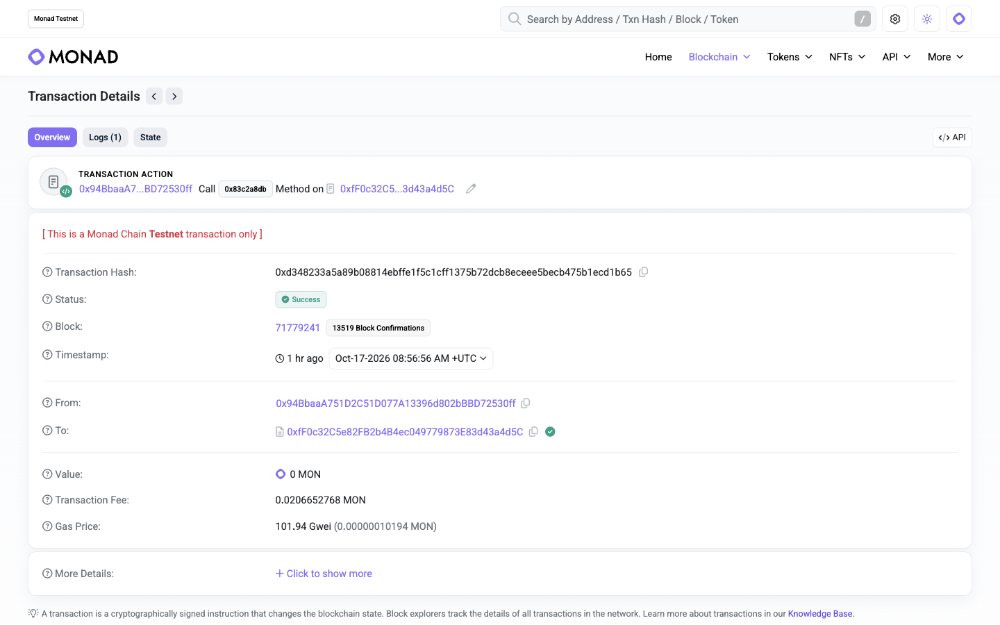

# 闪绘 · 像素据点战 / BlitzCanvas

**SpiritMan · Monad Blitz Shanghai · 2026-10-17**

九个据点、三种兵力、180 秒。玩家通过真实 Monad Testnet 交易派兵、占点、获得持续产出并反攻。Solidity 合约执行规则，网页呈现链上快照和已确认事件。

| 入口 | 内容与状态 |
|---|---|
| [在线游戏](https://blitzcanvas-monad-20261017.hardy369.chatgpt.site/) | v0.4.0，两阵营真实合约战场；每次调遣需钱包逐笔签名 |
| [新版地图预览](https://blitzcanvas-monad-20261017.hardy369.chatgpt.site/map) | 可拖动、缩放、点选的等距像素地图；四阵营、设施与驻军均为只读示例，尚未接入新版合约 |
| [中文解说字幕演示](https://blitzcanvas-monad-20261017.hardy369.chatgpt.site/demo.mp4) · [SRT 字幕](https://blitzcanvas-monad-20261017.hardy369.chatgpt.site/demo.srt) | 演示真实链证据与只读新地图；地图段不代表链上派兵 |
| [GitHub 源码](https://github.com/jiandanplus/monad) | 本仓库；含合约、前端、锁文件、原创运行时素材与测试 |
| [已部署合约](https://testnet.monadscan.com/address/0xfF0c32C5e82FB2b4B4ec049779873E83d43a4d5C) | Monad Testnet，chainId 10143 |

当前验收边界：**已核验新合约部署、开局及一个地址的一笔真实调遣；尚未完成不同地址的双阵营实战验收。新版地图不是四阵营链上多人对局。** 没有实测网络 TPS、平均确认时间或网络最终性数据。以下证据核验时间为 2026-10-17，具体见[参赛状态](docs/submission-status.md)。

## 先看真实证据

- 合约：`0xfF0c32C5e82FB2b4B4ec049779873E83d43a4d5C`，部署区块 `71778049`；部署交易 [0x24be…bbf7](https://testnet.monadscan.com/tx/0x24be4d321393335d21cafc053b107bf1a6cb790fce7405cd6b3dabe02d60bbf7)。已核验运行代码与当前 Solidity 编译产物逐字节一致，4,973 字节。
- 第 1 轮开局：[0x5fc3…70df](https://testnet.monadscan.com/tx/0x5fc3d1008456bbc136c4334a3c7a734ef63f2c3cdc386ceaa14e8d4c85c770df)，成功，区块 `71779168`，180 秒；该轮已结束。
- 第一笔真实调遣：[0xd348…1b65](https://testnet.monadscan.com/tx/0xd348233a5a89b08814ebffe1f5c1cff1375b72dcb8eceee5becb475b1ecd1b65)，成功，区块 `71779241`，调用 `cast(1,1,1,0)`。翡翠联盟步兵攻击陆家嘴，驻军 `20 → 2`、仍为中立，消耗 20 指挥点，事件 `pointsAfter=80`。公开无钱包读端看到相同变化。
- 此笔调遣 gas 为 `202720`，实际费用 `0.0206652768` 测试 MON。这是单笔历史观测，不能推导平均成本或吞吐能力。

2026-10-17 18:04（上海）再次通过独立公共 RPC 校验，区块 `71792741` 的运行代码仍匹配；第 1 轮总行动为 1，驻军保持 2，团队分数为 180:180。完整公开数据见 [JSON 核验记录](docs/real-orders-live-proof.json)，其中 `twoFactionAcceptancePassed=false`。截图显示同笔交易的成功状态、区块、发送者、合约和费用；它记录真实链证据，不是游戏操作模拟。



可使用[同一战场链接](https://blitzcanvas-monad-20261017.hardy369.chatgpt.site/?contract=0xfF0c32C5e82FB2b4B4ec049779873E83d43a4d5C&start=71778049)只读查看。历史事件需按上述哈希复核；只读验收脚本的有界近期扫描不保证包含所有旧事件。

## 玩法

翡翠联盟与赤焰军团争夺 3×3 地图。两方各有一座初始基地、驻军 60；其余据点中立、驻军 20。首次成功出兵将该地址锁定到本轮阵营。

| 兵种 | 指挥点成本 | 作用 | 冷却 |
|---|---:|---|---:|
| 步兵 | 20 | 18 攻击或增援 | 2 秒 |
| 坦克 | 50 | 50 攻击或增援 | 5 秒 |
| 工程师 | 35 | 接管中立点后驻军 30；友军增援 35；不能攻击敌军 | 3 秒 |

初始 100 指挥点，上限 200。首次成功行动后，基础恢复 3/秒，加上阵营占据据点产出。普通街区和基地每秒产出 1，矿场 2，中央能源站 3；占有时间同时累计团队统治分。个人收益从加入后计算。占领额外奖励 20 点，受上限约束。

进攻目标需与己方据点上下左右相邻；友方据点可直接增援。失去全部领土后可向任意目标反攻。攻击先扣驻军，击穿后占领，剩余攻击力成为新驻军且最低 10；友军驻军上限 100。无效操作不扣点、不增加行动、不锁定阵营。180 秒结束按累计统治分判胜，平分为平局；结束后资源与分数停止增长，历史回合可查询。

指挥点与统治分是局内数值，无代币、下注、奖金池、应用收费或资金托管。只需测试 MON 支付网络 gas。参与地址不等于独立人数。

## Monad 技术结合

1. **真实且可复核的 EVM 操作。** 每次调遣调用 `cast(expectedRoundId,district,team,unit)`，单独签名并产生交易哈希。成本、阵营、邻接、冷却、驻军、占领、资源约束由 Solidity 执行。只有链、合约、签名者、参数均匹配的成功回执才能确认战果。不存在模拟对手或失败后的本地战果回退。
2. **面向独立指令的存储结构。** 据点归属与产出槽和战斗计数、驻军槽分离。本地真实 EVM 的 SLOAD/SSTORE 轨迹验证：不同地址攻击不同中立据点、且未发生占领时，双方应用存储读写无冲突，可为 Monad 乐观并行执行提供独立工作。占领会改变邻接和资源关系，保留必要依赖。该证据仅覆盖限定场景，不代表全部动作可并行，也不是实测 Monad 网络 TPS。
3. **按需计算时间积分。** 合约通过据点时间检查点与累计产出计算团队分数及玩家资源，避免逐秒写链。网页插值明确标为估算；发交易前重读，真实结果以回执、事件和链上快照为准。
4. **共享可验证战场。** 无钱包访客可以读取相同合约。预期回合 ID 防止延迟签名影响新一轮；交易记录重载后只读复核，不自动重发。

实现入口：[合约](contracts/BlitzCanvas.sol)、[链适配器](src/chain.ts)、[钱包](src/wallets.ts)、[交易状态](src/transactions.mjs)、[存储轨迹测试](test/parallel-storage.test.mjs)。

## 本地运行与验证

使用 Node.js 22.23+ 或 24 及 npm。本项目原验证环境为 Node.js 22.23.1；依赖由 `package-lock.json` 锁定。

```sh
npm ci
npm test
npm run build
npm run dev
```

开发地址以终端输出为准（Vite 默认 `http://127.0.0.1:5173/`）。真实游戏在 `/`，只读地图在 `/map.html`。生产构建输出 `dist/`，包含双入口，部署到 HTTPS 静态托管；若希望使用公开站点的 `/map` 路径，托管侧需将其映射到 `map.html`。`dist/`、`node_modules/` 与私密配置不入库。

Solidity `0.8.30`，Shanghai EVM 目标，`viaIR: true`，优化器 200 次。`npm run build` 会先重编译合约、进行 TypeScript 检查再生成静态站点。Ganache 在 macOS 可能提示 µWS 原生二进制不可用并回退 JS 实现；测试仍执行真实本地 EVM。

本次公开仓库快照已复验：全量 79 项测试通过（0 失败、0 跳过），合约重编译、TypeScript 检查和双入口生产构建通过。测试包括真实本地 EVM、181 个连续时间点规则对照、资源与轮次边界、钱包账户变化、回执上下文、替换/拒签/取消/回退/超时、地图生命周期和投影。本地测试不等于真实测试网多人验收。

只读链上检查，不需要密钥，也不会广播交易：

```sh
node scripts/verify-live.mjs 0xfF0c32C5e82FB2b4B4ec049779873E83d43a4d5C 71778049 evidence.json
```

该脚本校验网络、运行代码、快照及近期两阵营回执；近期扫描有限，找不到两阵营证据会返回退出码 2。它不会把一笔单方交易当作双阵营通过。

## 钱包与部署

正式游戏使用 EIP-1193 钱包，支持 EIP-6963 发现。选取钱包后，明确选择实际授权的签名账户并切到 Monad Testnet（chainId `10143`），准备测试 MON。网页授权列表可能与钱包全局所选账户不同；每笔写入前重新核验，账户或网络变化会中止本次尝试，不静默换地址。

默认部署来自 [public/deployment.json](public/deployment.json)。如部署自己的战场：在页面点击部署并确认交易，随后单独开启首轮；通过带 `contract` 和 `start` 参数的链接共享。需要让所有访客使用新合约时，更新部署清单中的真实地址与部署区块并重新构建。运行代码必须匹配当前编译产物，旧存储布局不可复用。

私钥、助记词、钱包密码始终留在钱包。公开站点曾出现 MetaMask 恶意网站警告，原因与解决状态尚未确认。不要关闭钱包保护来完成演示；已有真实签名核验使用本机构建页面。

## 地图、美术与路线图

新版只读地图含 64×64 格等距世界、13 设施、20 道路、四阵营示例基地；支持拖动、WASD、缩放、小地图、设施/单位点选与相邻道路预览。页面显示“地图交互预览 / 示例驻军 / 未接入新版合约”，不连接钱包、不发交易、不扣兵、不改旗帜、不生成假战果。

原版战场采用原创程序化 Canvas2D 图形。新版建筑、树木和单位使用单独透明精灵，地形与道路分别渲染；原创生成记录和完整提示词见[素材说明](docs/map-art.md)。二维码本地生成，音效默认关闭并由浏览器合成。未使用《红色警戒》原版美术、音乐或标志。

`docs/superpowers/`、`docs/*plan*` 与设计文档记录产品规划和未来集成，不能作为完成证明。四阵营共享军费、持久部队、战斗和补给尚需新合约及四个可签名账户验收，见[路线图](docs/superpowers/plans/2026-10-17-four-faction-siege-roadmap.md)。[演示稿](docs/pitch.md)中的双阵营演示步骤需取得实际回执后执行。

## 资料与许可

- [比赛页面](https://mojo.devnads.com/events/17)
- [Monad 文档](https://docs.monad.xyz/)
- [viem 文档](https://viem.sh/)
- [EIP-6963](https://eips.ethereum.org/EIPS/eip-6963)

MIT License，见 [LICENSE](LICENSE)。运行时图片来源与生成过程见素材说明。本仓库从已发布版本的受跟踪文件制作，不包含原部署仓库 Git 历史、Sites 私有配置、环境密钥或凭据。
